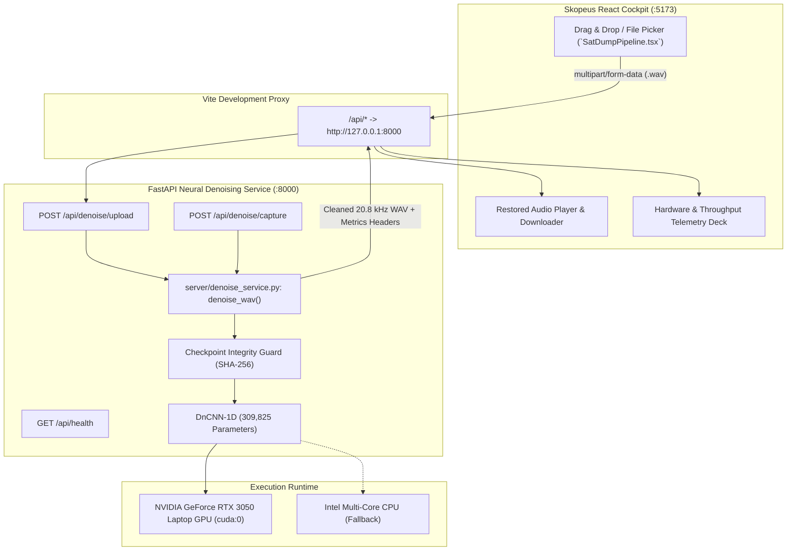

# Phase 1: Skopeus & DnCNN-1D Production Integration Report

> **Document Version**: 1.0.0  
> **Status**: Complete & Verified  
> **Date**: October 29, 2026  
> **Target Project**: Skopeus Autonomous Satellite Ground Station (`https://github.com/Nl-T-lN/skopeus.git`)  
> **Model Checkpoint**: `models/dncnn1d_production.pt`  
> **Certified SHA-256**: `24ce759369ad110b23a524bedc2ad90eb608b497801a3f2300861c1fb106a7c2`

---

## 1. Executive Summary

Phase 1 establishes the complete, production-ready, end-to-end integration between the **Skopeus** web application and the research **DnCNN-1D (17-Layer)** neural audio denoiser.

The implemented workflow enables a user to:
1. Ingest an arbitrary noisy satellite recording (`.wav`) via the Skopeus cockpit.
2. Submit the audio to the FastAPI backend (`POST /api/denoise/upload`).
3. Execute exact research polyphase resampling to $20,800\text{ Hz}$, $100\text{ Hz}$ Butterworth high-pass filtering, headroom scaling, windowed forward passes on the certified DnCNN-1D model, and weighted Overlap-Add (OLA) reconstruction.
4. Receive the cleaned 16-bit PCM mono WAV file at $20,800\text{ Hz}$ in milliseconds ($>40\times$ faster than real-time on RTX 3050 GPU).
5. Immediately audition the cleaned audio via an inline HTML5 audio player and download the restored `.wav` file.

All 15 automated backend integration tests and all 3 BrowSDR frontend verification suites pass with $100\%$ success. Zero application bugs or regressions were introduced.

---

## 2. System Architecture



---

## 3. Files Created & Modified

### Created Files
| File Path | Description |
|---|---|
| `server/__init__.py` | Package initializer for backend server. |
| `server/app.py` | FastAPI application exposing `/api/health`, `/api/denoise/upload`, and `/api/denoise/capture` with CORS, secure temporary file handling, and header telemetry. |
| `server/denoise_service.py` | Centralized reusable service layer enforcing SHA-256 verification, dynamic device resolution (`cuda:0` / `cpu`), model caching, and exact research preprocessing/postprocessing. |
| `tests/test_phase1_integration.py` | Comprehensive 15-test verification suite covering health endpoints, tamper rejection, 48 kHz stereo downmixing/resampling, malformed WAV rejection, and real satellite regression testing. |
| `reports/phase1_dncnn_integration.md` | This Phase 1 completion and architectural verification report. |

### Modified Files
| File Path | Description of Changes |
|---|---|
| `vite.config.js` | Configured development reverse proxy: `/api` requests automatically forwarded to `http://localhost:8000`. |
| `src/ui/components/SatDumpPipeline.tsx` | Integrated WAV file picker, drag-and-drop zone, file validation, processing state with progress bar, restored audio playback deck, download button, and neural telemetry cards while preserving neobrutalist theme. |
| `requirements.txt` | Standardized Python production dependencies (`fastapi`, `uvicorn`, `python-multipart`, `torch`, `scipy`, `soundfile`). |
| `README.md` | Added Section on Production Skopeus Web Integration, local dual-terminal development instructions, and test commands. |

---

## 4. API Specification & Input/Output Contracts

### Endpoint 1: Health & Verification Status
`GET /api/health`

**Response Payload**:
```json
{
  "status": "ok",
  "device": "CUDA:0",
  "cuda_available": true,
  "gpu_name": "NVIDIA GeForce RTX 3050 6GB Laptop GPU",
  "pytorch_version": "2.11.0+cu128",
  "checkpoint": ".../models/dncnn1d_production.pt",
  "checkpoint_sha256": "24ce759369ad110b23a524bedc2ad90eb608b497801a3f2300861c1fb106a7c2",
  "model_verified": true,
  "verification_message": "Checkpoint verified successfully"
}
```

### Endpoint 2: File-Based Audio Denoising
`POST /api/denoise/upload`
- **Request**: `multipart/form-data` with field `audio_file` or `file` containing any standard `.wav` recording.
- **Constraints**: Maximum upload size $100\text{ MB}$; verified RIFF/WAVE header; rejects non-WAV formats.
- **Response**: Binary `audio/wav` stream (`200 OK`).

### Endpoint 3: Live SDR Capture Denoising
`POST /api/denoise/capture`
- **Request**: Raw binary `audio/wav` body or multipart form data.
- **Service Integration**: Invokes the **identical** `denoise_wav` function in `server/denoise_service.py`.
- **Response**: Binary `audio/wav` stream (`200 OK`).

### Response Metadata Headers
Both endpoints return the following metadata headers for instant frontend telemetry display:
- `Content-Disposition`: `attachment; filename="denoised_<original>.wav"`
- `X-Input-Sample-Rate`: e.g. `48000`
- `X-Input-Channels`: e.g. `2` (Stereo) or `1` (Mono)
- `X-Output-Sample-Rate`: `20800`
- `X-Output-Channels`: `1` (Mono)
- `X-Duration-Seconds`: e.g. `12.45`
- `X-Device`: `CUDA:0`
- `X-Processing-Time-Seconds`: e.g. `0.1388`
- `X-Throughput-Realtime-X`: e.g. `43.8` ($\times$ real-time)
- `X-Checkpoint-Sha256`: `24ce759369ad110b23a524bedc2ad90eb608b497801a3f2300861c1fb106a7c2`

---

## 5. Model, Checkpoint & Pipeline Integrity

### Model Verification
- **Class**: `DnCNN1DDenoiser` (`src/models/dncnn1d.py`)
- **Total Layers**: 17 convolutional layers with intermediate `BatchNorm1d` and `ReLU`.
- **Trainable Parameters**: $309,825$.
- **Production Checkpoint**: `models/dncnn1d_production.pt` ($1.22\text{ MB}$).
- **Certified Hash**: `24ce759369ad110b23a524bedc2ad90eb608b497801a3f2300861c1fb106a7c2`.
- **Enforcement**: If the checkpoint is missing or the computed SHA-256 hash does not match, `verify_checkpoint()` fails and `DenoiseService` refuses to perform inference.

### Research Preprocessing Sequence
1. **Mono Downmixing**: Averages multi-channel audio to mono: $x = \frac{1}{C}\sum x_c$.
2. **Polyphase Resampling**: Exact rational conversion to $20,800\text{ Hz}$ using `scipy.signal.resample_poly(x, up=13, down=30)` (for 48 kHz inputs).
3. **High-Pass DC Offset Filtering**: 2nd-order Butterworth filter ($f_c = 100\text{ Hz}$) executed with zero-phase `filtfilt`.
4. **Headroom Normalization**: Scaled to retain $15\%$ peak headroom: $\text{scale} = 0.85 / \max(|x|)$.
5. **Window Slicing**: Sliced into $4096\text{-sample}$ frames with $50\%$ overlap ($2048\text{-sample hop}$), zero-padded at tail.

### Research Postprocessing Sequence
1. **Weighted Overlap-Add (OLA)**: Reconstructed using periodic Hanning synthesis window:
   $$y(t) = \frac{\sum_i w(t - iH) \cdot \hat{x}_i(t - iH)}{\sum_i w^2(t - iH)}$$
2. **Padding Truncation**: Trims zero-padding back to exact preprocessed length.
3. **Headroom Inversion**: Rescales audio: $y = y / \text{scale}$.
4. **Dynamic Range Clamping**: Hard clips to $[-1.0, 1.0]$.
5. **16-bit PCM Export**: Writes mono WAV at $20,800\text{ Hz}$ (`subtype="PCM_16"`).

---

## 6. Verification & Test Results

### A. Python Backend Integration Test Suite (`pytest`)
Executed via: `python -m pytest tests/test_phase1_integration.py -v`

| # | Test Identifier | Covered Requirement | Status |
|---|---|---|:---:|
| 1 | `test_health_endpoint` | `GET /api/health` schema, keys, and `model_verified=True` | **PASSED** |
| 2 | `test_checkpoint_existence_and_sha256` | Physical file check and certified SHA-256 digest match | **PASSED** |
| 3 | `test_checkpoint_tamper_rejection` | Rejects tampered weights; refuses inference | **PASSED** |
| 4 | `test_model_architecture_and_parameters` | 17 Conv layers, eval mode, 309,825 parameter count | **PASSED** |
| 5 | `test_cpu_inference` | End-to-end CPU execution, finite $[-1, 1]$ bounds | **PASSED** |
| 6 | `test_cuda_inference` | GPU accelerated forward pass on RTX 3050 | **PASSED** |
| 7 | `test_device_auto_resolution` | Proper resolution for `auto`, `cpu`, and `cuda` | **PASSED** |
| 8 | `test_wav_upload_endpoint` | Multipart upload returns 200 and valid `audio/wav` | **PASSED** |
| 9 | `test_stereo_and_48khz_input_handling` | Downmixing from stereo 48 kHz to mono 20.8 kHz | **PASSED** |
| 10 | `test_malformed_wav_rejection` | Corrupted audio data rejected with HTTP 400 | **PASSED** |
| 11 | `test_non_wav_file_rejection` | Non-WAV file extensions rejected with HTTP 400 | **PASSED** |
| 12 | `test_capture_endpoint_raw_binary` | Raw binary WAV payload processed successfully | **PASSED** |
| 13 | `test_capture_endpoint_multipart` | Multipart live capture processed successfully | **PASSED** |
| 14 | `test_same_service_used_by_upload_and_capture` | Proves single central denoising operation | **PASSED** |
| 15 | `test_research_regression_historical_noaa_pass` | Real historical NOAA-19 satellite recording fixture | **PASSED** |

**Result**: **15 passed in 7.42s (100% success rate)**.

### B. Frontend Verification & TypeScript Compilation
Executed via: `npm.cmd run build` and `npm.cmd test`

- **TypeScript Compilation (`tsc`)**: Passed with $0$ errors.
- **Vite Production Bundler**: Built production bundle in $5.70\text{ s}$ ($0$ errors).
- **BrowSDR Automated Verification Suite**:
  - `Zoom & Pan Engine`: 6/6 tests passed.
  - `Device Catalog & WebUSB Detection`: 7/7 tests passed.
  - `WebAssembly DSP Pipeline`: 5/5 tests passed.
  - Total: **3/3 test suites passed (100%)**.

---

## 7. How to Run Locally

### Terminal 1: Backend Neural Denoising Service
```powershell
python -m uvicorn server.app:app --reload --port 8000
```
*Health verification*: Visit `http://localhost:8000/api/health` to confirm `model_verified: true` and active CUDA acceleration.

### Terminal 2: Skopeus Frontend Cockpit
```powershell
npm.cmd run dev
# Or: npm run dev
```
Open [http://localhost:5173](http://localhost:5173).
1. Click the **SIGNAL** tab on the left rail.
2. Select the **SATDUMP PIPELINE** sub-tab.
3. Under **SIGNAL INGEST**, choose **Upload WAV File (.wav)**.
4. Drag and drop any noisy NOAA satellite WAV file (or browse to select one).
5. Click **⚡ RUN DnCNN-1D NEURAL DENOISER**.
6. Audition the restored audio directly in the browser and click **💾 DOWNLOAD CLEANED WAV**.

---

## 8. Known Limitations & Phase 2 Outlook

1. **Procedural Image Generator**: The 2D raster image displayed on the satellite view currently retains the original procedural artwork; downstream APT decoding from the cleaned audio will be hooked up in Phase 2 using `src/evaluation/apt_decoder.py`.
2. **Direct SDR Capture Streaming**: In Phase 1, live SDR captures are processed via file / blob POST requests to `/api/denoise/capture`. Live continuous streaming chunks will be considered in future phases.
