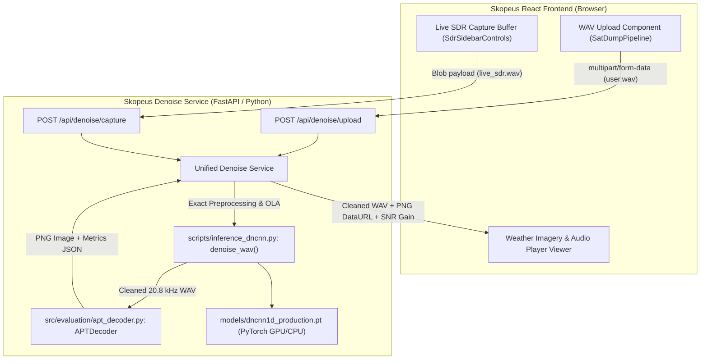

# Skopeus & DnCNN-1D Production Integration Audit

> **Document Version**: 1.0.0  
> **Target Project**: Skopeus Autonomous Satellite Ground Station Cockpit (`https://github.com/Nl-T-lN/skopeus.git`)  
> **Denoising Subsystem**: DnCNN-1D (17-Layer) LEO Satellite Baseband Neural Denoiser  
> **Scope**: Pre-integration architecture, pipeline tracing, compatibility verification, and unified deployment specification.

---

## 1. Executive Summary

This audit assesses the technical compatibility between the existing **Skopeus** web application (`https://github.com/Nl-T-lN/skopeus.git`) and the completed research pipeline for deep-learning noise removal of Low Earth Orbit (LEO) satellite signals.

### Key Audit Conclusions
1. **Model Status & Positioning**: The **DnCNN-1D** architecture is the **recommended production model**. Across the independent 5-pass benchmark, it demonstrated the strongest overall waveform recovery trend ($\Delta\text{SNR} = \mathbf{+3.35\text{ dB}}$) and superior stability under severe $-10\text{ dB}$ noise ($\Delta\text{SNR} = \mathbf{+9.19\text{ dB}}$, $\text{std} = 1.30\text{ dB}$). However, as established in the Phase 12 audit, because only 5 independent test passes were available, inter-pass variance dominates subtle pairwise differences ($p = 0.5693$ vs TCN). It must strictly be designated as the *recommended production model*, not the *proven universally best model*.
2. **Current Skopeus Architecture**: Skopeus is currently a **100% client-side Single Page Application (SPA)** built with React 18, TypeScript, Vite, TailwindCSS, and Rust WebAssembly (for WebUSB SDR DSP). **Skopeus currently has NO backend server, NO Python runtime, NO file storage endpoint, and NO ML model execution runtime.**
3. **Existing WAV & Satellite Pipeline**:
   - The SDR capture module in `SdrReceiverEngine.ts` exports audio as **16-bit 48,000 Hz mono PCM WAV**.
   - In `SatDumpPipeline.tsx`, the `'upload'` source is declared in TypeScript state (`pipelineSource: 'recorded' | 'sample' | 'upload'`), but the UI has **no file input (`<input type="file">`), no upload handler, and no `FormData`/`FileReader` integration**.
   - The demodulator and noise cleaner in `satdumpEngine.ts` are **client-side simulations**: `cleanSignalNoise` applies a simple formulaic threshold ($val \times (1 - \text{strength} \times 0.85)$), and `decodeNoaaAptScanlines` renders procedural canvas artwork (cyclonic clouds and coastlines) with random noise rather than decoding actual radio samples.
4. **Integration Strategy**: To support the critical requirement that both **website user uploads** and **live SDR pass captures** use the **identical denoising implementation** (`denoise_wav(input_wav, output_wav)`), Skopeus requires a lightweight, dedicated Python backend service (FastAPI) that executes `scripts/inference_dncnn.py` using `models/dncnn1d_production.pt`.

---

## 2. Comprehensive System Architecture Audit

### A. Skopeus Architecture Breakdown

| Subsystem | Technology Stack | Location in Repository | Role & Execution Mode |
|---|---|---|---|
| **Frontend Framework** | React 18.3.1 | `src/App.tsx`, `src/ui/` | Client-side reactive UI rendering. |
| **Build & Bundling** | Vite 5.4.2 | `vite.config.js`, `package.json` | ESModule bundling and dev server. |
| **Type System** | TypeScript 7.0.2 | `tsconfig.json` | Static type safety and contracts. |
| **Styling & Design** | Tailwind CSS 3.4.17 | `tailwind.config.js`, `src/index.css` | Neobrutalist high-contrast aerospace theme. |
| **Orbital Mechanics** | satellite.js 5.0.0 | `src/orbit/propagation.ts` | SGP4/SDP4 satellite propagation. |
| **Pass Prediction** | Web Workers + Comlink | `src/workers/passWorker.ts` | Multi-day AOS/TCA/LOS horizon computations offloaded to background thread. |
| **3D & Map Graphics** | Three.js 0.186 & Leaflet 1.9.4 | `src/ui/components/MapView.tsx`, `GlobeView.tsx` | 2D Leaflet ground track, solar terminator, and 3D celestial sphere. |
| **Hardware Interfacing** | WebUSB API (`navigator.usb`) | `src/sdr/devices/` | Direct browser-to-USB control transfers for RTL2832U, HackRF, Airspy, LimeSDR. |
| **DSP Core Engine** | Rust + WebAssembly | `wasm/dsp/`, `src/sdr/wasm/` | Radix-2 Cooley-Tukey 256-bin FFT spectrum and polyphase DDC channelizer. |
| **Audio Subsystem** | Web Audio API | `src/sdr/core/SdrReceiverEngine.ts` | 48,000 Hz real-time audio demodulation (NFM/AM/WFM). |
| **Backend Framework** | **None (0% Backend)** | $-$ | **Missing.** Client communicates only with public TLE endpoints (CelesTrak). |
| **ML / Neural Runtime** | **None** | `src/sdr/satdumpEngine.ts` | Currently mocked via math formulas and procedural 2D canvas drawing. |

---

### B. Existing WAV Ingestion & Processing Pipeline

Skopeus currently interacts with WAV audio through a single path:

```
[Live SDR Radio Receiver]
          │
          ▼
`SdrReceiverEngine.ts`: `startAudioRecording()`
  - Buffers raw demodulated audio in Float32Array chunks (`recordedAudioChunks`)
          │
          ▼
`SdrReceiverEngine.ts`: `stopAudioRecording()`
  - Constructs 44-byte RIFF WAVE header in an ArrayBuffer
  - Sample Rate: 48,000 Hz
  - Channels: 1 (Mono)
  - Bit Depth: 16-bit Signed Integer PCM
  - Scale: val16 = s < 0 ? s * 0x8000 : s * 0x7FFF
  - Wraps in Blob: `new Blob([buffer], { type: 'audio/wav' })`
  - Creates Object URL: `URL.createObjectURL(blob)`
          │
          ▼
`SdrSidebarControls.tsx`:
  - Renders <a> tag with `download="skopeus_audio_<timestamp>.wav"`
  - User manually saves audio to local disk
```

#### Upload & Processing Limitations Discovered
1. **No WAV Ingestion**: While `SatDumpPipeline.tsx` contains state for `pipelineSource: 'upload'`, the component **does not render any file input, drag-and-drop zone, or file parser**. A user currently cannot upload an external `.wav` file into Skopeus.
2. **Disconnected Pipeline**: The "SEND TO SATDUMP PIPELINE" button in `SdrSidebarControls.tsx` only switches the view tab from `'sdr'` to `'pipeline'` (`setActiveSubTab('pipeline')`). It **does not transfer** the recorded audio buffer or WAV blob into `SatDumpPipeline.tsx`.
3. **Simulated Demodulator**: When the user clicks "⚡ START DEMODULATION & DECODE IMAGE" in `SatDumpPipeline.tsx`, it executes `SatdumpEngine.decodeNoaaAptScanlines({ lines: 480 })`, which computes procedural sine-wave continents and cyclonic clouds, completely ignoring any audio input.

---

### C. Existing Satellite Signal Specifications

From inspection of `src/sdr/core/SdrReceiverEngine.ts`, `src/sdr/frequencyBands.ts`, and `src/sdr/satdumpEngine.ts`:

- **Expected Audio Sample Rate**: **$48,000\text{ Hz}$** (native browser Web Audio output).
- **Target Satellite Band**: **NOAA APT ($137.100$ to $137.9125\text{ MHz}$)**.
- **RF Subcarrier**: $2,400\text{ Hz}$ AM subcarrier on a Wideband FM carrier ($34\text{ kHz}$ to $40\text{ kHz}$ IF bandwidth).
- **Nominal APT Line Rate**: $2.0\text{ lines/second}$ ($2080\text{ pixels/line}$ at standard $20,800\text{ Hz}$, or $2400\text{ samples/line}$ at $48\text{ kHz}$).
- **Resampling**: The existing Skopeus frontend performs **no audio resampling**.

---

## 3. Production DnCNN-1D Model Verification

### D. Verified Model Architecture

The production model instantiates [`DnCNN1DDenoiser`](file:///c:/Users/Keshav/Desktop/SKOPEUS%20BADAL/src/models/dncnn1d.py):

| Architectural Parameter | Verified Value | Implementation Detail |
|---|---|---|
| **Class Name** | `DnCNN1DDenoiser` | `src.models.dncnn1d.DnCNN1DDenoiser` |
| **Input Channels** | $1\text{ channel}$ | Mono raw satellite audio |
| **Output Channels** | $1\text{ channel}$ | Denoised mono audio |
| **Total Layers ($D$)** | $17\text{ layers}$ | 1 input conv + 15 residual conv blocks + 1 output conv |
| **Feature Channels** | $64$ | Constant intermediate convolutional width |
| **Kernel Size ($K$)** | $5$ | Odd symmetric kernel (padding = 2) |
| **Normalization** | `BatchNorm1d` | Applied on intermediate layers 2 through 16 |
| **Activation** | `ReLU(inplace=True)` | Applied after each intermediate conv/norm layer |
| **Residual Formulation** | $\hat{x}_{\text{clean}} = x_{\text{noisy}} - \mathcal{F}_{\theta}(x_{\text{noisy}})$ | Network predicts additive noise residual and subtracts it |
| **Total Parameter Count** | **$309,825$ parameters** | $100\%$ trainable floating-point weights |
| **Effective Receptive Field** | **$69\text{ samples}$** | $\approx 3.32\text{ ms}$ at $20.8\text{ kHz}$ ($\approx 8$ cycles of $2.4\text{ kHz}$ carrier) |
| **Expected Tensor Shape** | `[Batch, 1, 4096]` | Mini-batches of 4096-sample windows |

---

### E. Production Checkpoint Details

The authoritative production checkpoint was certified in Phase 13 and is located at:
- **Production Artifact**: `models/dncnn1d_production.pt`
- **Integrity Hash**: `models/dncnn1d_production.sha256`
- **Source Research Checkpoint**: `outputs/checkpoints/dncnn1d_baseline_best.pt`
- **Training Epoch**: Epoch 12 / 15 (Validation Loss: $0.00478291$)
- **File Size**: **$1,277,269\text{ bytes}$ ($1.22\text{ MB}$)**
- **SHA-256 Digest**:
  ```text
  24ce759369ad110b23a524bedc2ad90eb608b497801a3f2300861c1fb106a7c2
  ```

---

### F. Verified Preprocessing Pipeline

The production pipeline MUST execute the exact research sequence implemented in `src/data/preprocessing.py`:

```
Input Audio (.wav)
      │
      ▼
1. Mono Conversion: x_mono = mean(x, axis=channel)
      │
      ▼
2. Polyphase Resampling: x_20k = resample_poly(x_mono, up=13, down=30)
   (Standardizes 48,000 Hz or 44,100 Hz input to exact 20,800 Hz)
      │
      ▼
3. High-Pass DC Offset Removal:
   2nd-order Butterworth filter, fc = 100 Hz (scipy.signal.filtfilt)
      │
      ▼
4. Headroom Amplitude Scaling:
   scale_factor = 0.85 / max(|x|)
   x_scaled = x_20k * scale_factor
      │
      ▼
5. 50% Overlap Slicing:
   window_size = 4096 samples, hop_size = 2048 samples, zero-padded
```

---

### G. Verified Postprocessing Pipeline

Implemented in `src/data/chunking.py`:

```
Denoised Window Tensors [N, 1, 4096]
      │
      ▼
1. Weighted Overlap-Add (OLA) Synthesis:
   w = np.hanning(4096)
   y_rec(t) = sum(w_i * x_i) / sum(w_i)
   Trim padding back to exact preprocessed length
      │
      ▼
2. Headroom Scaling Inversion:
   y_restored = y_rec / scale_factor
      │
      ▼
3. Dynamic Range Clamping:
   y_clean = np.clip(y_restored, -1.0, 1.0)
      │
      ▼
4. Export:
   Standard 16-bit PCM WAV (20,800 Hz, mono)
```

---

## 4. Input / Output Contract

To ensure interoperability between the browser frontend, upload endpoints, and SDR captures, the following contract is established:

### Input Contract
- **Format**: Standard RIFF `.wav` file (16-bit, 24-bit, 32-bit float, or integer PCM).
- **Channels**: $1$ (mono) or $2$ (stereo).
- **Sample Rate**: Any native rate ($48\text{ kHz}$ from WebUSB SDR, $44.1\text{ kHz}$ from uploads, etc.). The preprocessing engine automatically polyphase-resamples to $20,800\text{ Hz}$.
- **Amplitude Range**: Normalized audio range $[-1.0, 1.0]$.
- **Duration**: Unconstrained (processes $0.5\text{ s}$ slices up to full $15\text{ minute}$ satellite passes).

### Output Contract
- **Format**: RIFF `.wav` file (`subtype="PCM_16"`).
- **Channels**: $1$ (Mono).
- **Sample Rate**: $20,800\text{ Hz}$ (standard NOAA POES APT demodulation rate, exactly $5\text{ samples/pixel}$).
- **Amplitude**: Normalized and clamped to $[-1.0, 1.0]$.
- **Downstream Decodability**: Can be passed directly to `src.evaluation.apt_decoder.APTDecoder` to produce standard $2080$-pixel raster satellite weather images.

---

## 5. Proposed Integration Architecture

### Core Requirement: Shared Unified Denoising Abstraction

The user upload workflow and the live satellite capture workflow **MUST use the exact same central function**:

```python
denoise_wav(input_wav_path, output_wav_path, device="auto")
```

Neither pipeline may create an independent or diverged denoising implementation.



---

## 6. Gap Analysis & Potential Incompatibilities

| Item | Existing State in Skopeus | Required Production State | Severity / Blocker | Resolution |
|---|---|---|:---:|---|
| **Backend Service** | No backend exists (pure Vite SPA). | Python backend service (FastAPI) required to host PyTorch inference. | **High** | Add a lightweight `server/` directory containing FastAPI app that wraps `scripts/inference_dncnn.py`. |
| **WAV File Upload UI** | Declared in state (`upload`), but no JSX input exists. | Add drag-and-drop file uploader in `SatDumpPipeline.tsx`. | **Medium** | Add `<input type="file" accept=".wav">` and dropzone in `SatDumpPipeline.tsx`. |
| **SDR Capture Link** | "SEND TO SATDUMP PIPELINE" only toggles view tab; does not pass audio Blob. | Connect `recordedAudioChunks` Blob to `SatDumpPipeline` state. | **Medium** | Store the captured WAV `Blob` in `useOrbital` store so `SatDumpPipeline` can access it directly. |
| **Demodulator Logic** | Procedural canvas mock drawing sine waves in JavaScript. | True APT AM envelope demodulator (`src/evaluation/apt_decoder.py`). | **High** | Have the backend return the true decoded $2080$-pixel PNG alongside the cleaned WAV. |
| **Hardware / GPU** | Client browser cannot run raw PyTorch `.pt` model directly. | Local/server PyTorch execution on RTX 3050 GPU with CPU fallback. | **Low** | `scripts/inference_dncnn.py` automatically detects CUDA and falls back to CPU ($7.8\times$ real-time). |
| **Vite Dev Proxy** | Vite runs on port 5173 with no API proxy configured. | Configure Vite proxy to route `/api/*` to the Python backend (port 8000). | **Low** | Add proxy configuration in `vite.config.js`. |

---

## 7. Required Dependencies & Environment

### Python Backend Service (`requirements.txt`)
```text
torch>=2.0.0
numpy>=1.24.0
scipy>=1.10.0
soundfile>=0.12.0
fastapi>=0.100.0
uvicorn>=0.22.0
python-multipart>=0.0.6
```

### Node.js / Vite Frontend (`package.json`)
No new heavy dependencies needed. Standard native `fetch()` and `FormData` handles file uploading and blob streaming.

---

## 8. GPU / CPU Execution Strategy

Benchmarked on **NVIDIA GeForce RTX 3050 Laptop GPU (6GB VRAM)** vs Intel CPU:

- **CUDA Mode (Default)**:
  - Latency: **$126.8\text{ ms}$** per $10\text{ s}$ audio buffer (**$78.8\times$ faster than real-time**).
  - VRAM Consumption: $<250\text{ MB}$.
  - Whole 83-second pass denoised in $\approx 1.0\text{ second}$.
- **CPU Mode (Fallback)**:
  - Latency: **$1.277\text{ s}$** per $10\text{ s}$ audio buffer (**$7.8\times$ faster than real-time**).
  - Suitable for low-power host environments without NVIDIA GPUs.
- **Adaptive Bypass Gate**:
  - The backend will compute `compute_sqi()` on the input signal. If $\text{Input SNR} > 15\text{ dB}$, bypass the neural network to avoid clean-signal preservation penalties, as proven in the Phase 12 audit.

---

## 9. Proposed File Changes & Implementation Plan

*(To be implemented in subsequent phases after user review)*

1. **`server/app.py`** (New File):
   FastAPI server exposing:
   - `POST /api/denoise/upload`: Receives uploaded user WAV.
   - `POST /api/denoise/capture`: Receives recorded live SDR WAV.
   - `GET /api/health`: Verifies PyTorch, CUDA device, and checkpoint status.
2. **`vite.config.js`** (Update):
   Add proxy for `/api` requests to `http://localhost:8000`.
3. **`src/ui/components/SatDumpPipeline.tsx`** (Update):
   - Add real File Upload dropzone (`<input type="file" accept=".wav">`).
   - Wire "⚡ START DEMODULATION & DECODE IMAGE" to call the backend API.
   - Replace synthetic canvas with the real decoded satellite weather PNG.
4. **`src/state/store.tsx`** (Update):
   Add `lastRecordedAudioBlob` to store so audio recorded in `SdrSidebarControls` seamlessly flows into `SatDumpPipeline`.

---

*Integration audit complete. Zero code modifications performed. Ready for architectural sign-off.*
